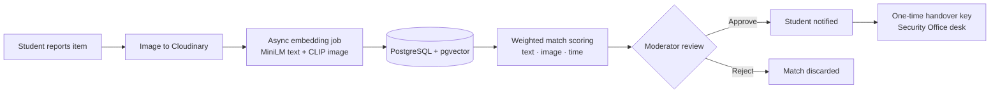

<div align="center">

<h1>Akarsh Mishra</h1>

<p><b>Backend Engineer</b> &nbsp;·&nbsp; Java &nbsp;·&nbsp; Spring Boot &nbsp;·&nbsp; Security</p>

<p>I design the parts of a system users never see but always rely on:<br/>authentication, payments, and search that works.</p>


<p>
<a href="https://akarshmi.dev"></a>
<a href="https://www.linkedin.com/in/akarshmi/"></a>
<a href="mailto:akarshmi.am@gmail.com"></a>
<a href="https://www.hackerrank.com/akarshmi"></a>
</p>

</div>

<br/>

## `// about`

<table>
<tr>
<td width="62%" valign="top">

I'm a backend engineer in the making, currently pursuing my **MCA at Lovely Professional University** (graduating 2027). I like the part of software that users never see but always feel: the login that stays secure, the payment that never double-charges, the search that actually finds the right thing.

**What I work on**
- **Security first:** JWT with revocation, OAuth2, RBAC, hashed OTPs and HttpOnly cookie sessions
- **Reliable money flows:** webhook-verified payments, idempotent processing, optimistic locking
- **AI in the backend:** embeddings, vector similarity search and event-driven matching
- **Clean architecture:** layered services, interface-driven design, secure defaults

**How I work**
I build complete products, not just endpoints: backend, deployment, docs and a client on top. I've led a 5-person team to a **Top 10 finish out of 200+ teams** at Smart India Hackathon 2025, and I enjoy turning rough ideas into running systems.

**Right now**
Building **UniTrace**, an AI-powered campus Lost & Found, and **Jobescape**, a self-hostable job aggregator. Looking for backend and software engineering opportunities where I can ship real systems and keep learning.

</td>
<td width="38%" valign="top">


```yaml
name      : Akarsh Mishra
role      : Backend Engineer
stack     : Java · Spring Boot
studying  : MCA, LPU (2027)
location  : Uttar Pradesh, India
focus     :
  - Authentication & security
  - Payment systems
  - Vector search & AI
  - API design
building  :
  - UniTrace
  - Jobescape
open_to   : Backend roles & internships
```

</td>
</tr>
</table>

<br/>

## `// skills`

<div align="center">


**Language**

[](https://skillicons.dev)

**Backend**

[](https://skillicons.dev)

**Databases**

[](https://skillicons.dev)

**Tools & Deployment**

[](https://skillicons.dev)

<sub>Security: OAuth2 · JWT (RS256) · RBAC · Argon2 / BCrypt · HMAC &nbsp;|&nbsp; Also used in projects: Python · Next.js</sub>

</div>

<br/>

## `// flagship project`

<table>
<tr>
<td>

### UniTrace &nbsp;·&nbsp; AI-Powered University Lost & Found
*Campus-scale platform that matches lost and found items with text and image embeddings, with moderated handover at the Security Office.*



| | |
|---|---|
| **Matching** | Text + image embeddings, pgvector similarity search, weighted score with event time-window factor |
| **Pipeline** | Event-driven: matching fires once an item's embeddings are generated |
| **Privacy** | No contact details shared; moderator approval and one-time handover key for every claim |
| **Auth** | Email-OTP signup (HMAC-hashed OTPs in Redis, atomic Lua verify), Argon2 passwords, JWT access tokens with JTI-based refresh tokens in HttpOnly cookies |
| **Roles** | Student · Moderator · Admin |


</td>
</tr>
</table>

<br/>

## `// selected work`

<table>
<tr>
<td valign="top" width="50%">

#### Unitrix &nbsp;`Event Ticketing`
Booking backend where tickets are generated only after webhook-confirmed payment.

- Razorpay with HMAC-SHA256 verification on raw request bodies
- Optimistic locking (`@Version`) on inventory; scheduler expires stale orders
- OTP-verified registration, password reset, organizer approval workflow
- Companion **UniTickets** frontend in Next.js and shadcn/ui

`Spring Boot` `PostgreSQL` `Razorpay` `JWT`

</td>
<td valign="top" width="50%">

#### AuthPlus &nbsp;`Auth Framework`
Reusable authentication backbone built to drop into microservices.

- JWT (RS256), OAuth2 login, RBAC across 15+ endpoints
- BCrypt hashing, HTTP-only cookie sessions
- Zero-downtime deploys on Render
- Cut integration time by ~40%

`Spring Security` `Next.js` `Redis` `Docker`

</td>
</tr>
<tr>
<td valign="top" width="50%">

#### Jobescape &nbsp;`Job Aggregator`
Multi-platform job scraper with resume upload that pre-fills search filters. Self-hostable via Docker Compose.

- FastAPI with async scrape jobs and status / results / download endpoints
- Excel export with application-tracking columns

[`Repository`](https://github.com/akarshmi/jobescape) &nbsp; `Python` `FastAPI` `Next.js`

</td>
<td valign="top" width="50%">

#### Jobify &nbsp;`Ingestion Service`
Pluggable job-ingestion backend with run tracking and deduplication.

- `JobSource` abstraction keeps the service independent of any provider
- Per-run created / updated / skipped counts, failure tracking

`Java` `Spring Boot` `Hibernate` `PostgreSQL`

</td>
</tr>
<tr>
<td valign="top" width="50%">

#### QuiLink &nbsp;`URL Shortener`
Live on a custom domain with click analytics.

- Snowflake IDs with Base62 codes, TTL indexes
- Atomic click counting in MongoDB Atlas
- Dockerized deploy on Render

`Spring Boot` `MongoDB` `Next.js`

</td>
<td valign="top" width="50%">

#### StayLedger &nbsp;`Desktop App`
Offline-first Windows app for PG and hostel management.

- Occupancy-based rent, deposit ledger with refunds
- Automatic late fees and overdue reports
- Encrypted manual backup to Google Drive

`JavaFX` `SQLite` `Java 21`

</td>
</tr>
<tr>
<td valign="top" colspan="2">

#### Scholar Forge &nbsp;`Academic Marketplace`
Students publish, discover and peer-review academic projects. Multi-provider OAuth2, JWT dual-token rotation, microservices backend. **35% faster queries**, 50+ reviewers supported. &nbsp; `Next.js` `Spring Boot` `PostgreSQL`

</td>
</tr>
</table>

<br/>

## `// achievements`

<table>
<tr>
<td width="72%" valign="top">

**Team Lead & Backend Developer · Smart India Hackathon 2025**

Led a 5-person cross-functional team (data science, UI/UX, cloud) through a 36-hour national hackathon. Designed the REST API, ran agile sprints, shipped an MVP with React, n8n and Node.js, and presented architecture and business model to the judging panel.

</td>
<td width="28%" align="center" valign="middle">


</td>
</tr>
</table>

<br/>

## `// certifications`

| Certification | Issuer | Year |
|:--|:--|:-:|
| Software Engineering Virtual Program | Goldman Sachs (Forage) | 2025 |
| Solutions Architecture | Amazon Web Services | 2024 |
| Software Engineer Intern | HackerRank | 2024 |

<br/>

## `// github`

<div align="center">


[](https://github.com/akarshmi)

</div>

<br/>

<div align="center">


*Build things that matter. Write code that lasts.*

</div>
